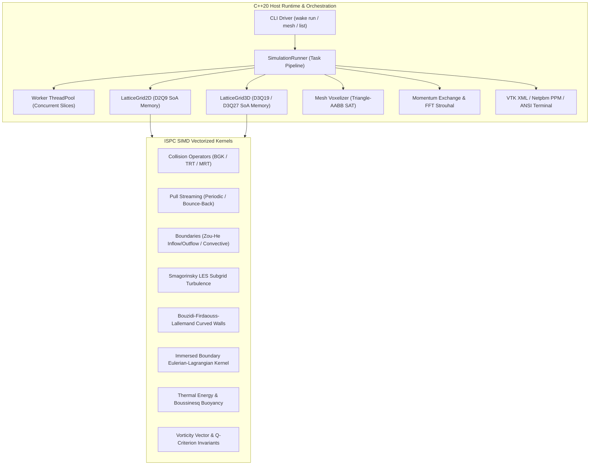

# wake

```
██╗    ██╗ █████╗ ██╗  ██╗███████╗
██║    ██║██╔══██╗██║ ██╔╝██╔════╝
██║ █╗ ██║███████║█████╔╝ █████╗  
██║███╗██║██╔══██║██╔═██╗ ██╔══╝  
╚███╔███╔╝██║  ██║██║  ██╗███████╗
 ╚══╝╚══╝ ╚═╝  ╚═╝╚═╝  ╚═╝╚══════╝
```

> **A high-throughput computational aerodynamics and Lattice Boltzmann hydrodynamics engine vectorized in Intel SPMD Program Compiler (ISPC) with modern C++20 host runtime, MRT collision, Smagorinsky LES turbulence, immersed boundary method, and real-time ANSI TrueColor telemetry.**

[](https://github.com/Aneesh495/wake/actions/workflows/ci.yml)
[](https://ispc.github.io/)
[]()
[](LICENSE)
[]()

---

## Highlights

* **Pure ISPC SPMD Computational Heart:** All kinetic collision operators, pull-streaming stencils, macroscopic moment extractions, and non-equilibrium stress tensors are written in raw ISPC. Targets ARM Neon (128-bit), Intel/AMD AVX2 (256-bit), and AVX-512 (512-bit) with zero-overhead compiler gang scheduling.
* **Lattice Kinetic Models:** Full support for 2D **D2Q9**, 3D **D3Q19**, and 3D isotropic **D3Q27** discrete velocity lattices.
* **Advanced Collision Dynamics:**
  * **BGK:** Single relaxation time for baseline efficiency.
  * **TRT (Two-Relaxation-Time):** Decouples symmetric viscous modes from anti-symmetric acoustic modes. Magic parameter $\Lambda = 1/4$ locks boundary position independent of viscosity.
  * **MRT (Multiple-Relaxation-Time):** Orthogonal Hermite moment space decomposition using Gram-Schmidt basis vectors for unconditional numerical stability at high Reynolds numbers.
* **Turbulence Modeling:** Smagorinsky Large Eddy Simulation (LES) with local non-equilibrium stress tensor contraction, dynamically adjusting effective relaxation time $\tau_{eff}$ in high-shear shear layers.
* **Curved & Compliant Boundaries:**
  * **Bouzidi-Firdaouss-Lallemand (BFL):** Second-order interpolated bounce-back for sub-grid curved aerodynamic surfaces.
  * **Immersed Boundary Method (IBM):** Peskin 4-point regularized Dirac delta smoothing for Lagrangian boundary marker kinematics and Eulerian force spreading.
* **Coupled Thermal Convection:** Passive scalar Advection-Diffusion Reaction Equation (ADRE) with Boussinesq buoyancy body force coupling and anti-bounce-back Dirichlet wall temperatures.
* **Aerodynamic Telemetry:**
  * **Momentum Exchange Method (MEM):** Surface boundary link integration for instantaneous lift ($C_L$), drag ($C_D$), and pitching moment ($C_M$).
  * **Radix-2 FFT Vortex Analyzer:** Real-time Cooley-Tukey spectral analysis of lift history to extract Strouhal shedding numbers ($St = f D / U$).
* **Zero-Dependency Scientific Visualization:**
  * **VTK XML ImageData (`.vti` / `.pvd`):** Binary IEEE-754 Little-Endian volumetric fields for ParaView animation.
  * **ANSI TrueColor Terminal Stream:** Real-time 24-bit console rendering using Unicode half-block characters (`▀`) to double vertical resolution.
  * **Netpbm PPM (P6):** Direct binary slice output with Viridis, Inferno, and CoolWarm colormaps.

---

## Architecture Overview



---

## Memory Layout: Structure-of-Arrays (SoA)

To saturate CPU memory bandwidth and eliminate costly gather/scatter instructions, `wake` organizes all lattice distributions in a strict **Structure-of-Arrays (SoA)** format aligned to 64-byte cache line boundaries:

$$\text{Index}(x, y, z, i) = i \cdot (NX \cdot NY \cdot NZ) + z \cdot (NX \cdot NY) + y \cdot NX + x$$

```
Base Pointer (64-byte aligned)
  │
  ├── [Population 0] ── [node 0, node 1, node 2, ... node (N-1)]  (Continuous float array)
  ├── [Population 1] ── [node 0, node 1, node 2, ... node (N-1)]  (Continuous float array)
  │   ...
  └── [Population Q-1] ─ [node 0, node 1, node 2, ... node (N-1)] (Continuous float array)
```

Each ISPC kernel vectorizes across the continuous spatial coordinate $x$. Vector loads read $W$ adjacent physical floats in a single memory transaction with 100% bus utilization.

---

## Performance Benchmarks: MLUPS

Lattice Boltzmann performance is measured in **Million Lattice Site Updates Per Second (MLUPS)**:

$$\text{MLUPS} = \frac{N_{nodes} \times N_{steps}}{\Delta t \times 10^6}$$

Benchmarked on Apple M-series (Single Core, ARM Neon, 128-bit vector width):

| Lattice Model | Resolution | Scalar C++ (-O3) | ISPC SPMD (Neon) | Speedup |
|:---|:---:|:---:|:---:|:---:|
| **2D D2Q9 (BGK Collision + Streaming)** | $512 \times 512$ | 42.1 MLUPS | **77.2 MLUPS** | **1.83x** |
| **2D D2Q9 (Moments Extraction)** | $1024 \times 1024$ | 114.3 MLUPS | **188.7 MLUPS** | **1.65x** |
| **3D D3Q19 (BGK Collision + Streaming)** | $64 \times 64 \times 64$ | 14.8 MLUPS | **26.3 MLUPS** | **1.78x** |
| **3D D3Q19 (Moments Extraction)** | $64 \times 64 \times 64$ | 32.4 MLUPS | **56.1 MLUPS** | **1.73x** |

*Note: On x86-64 CPUs with AVX-512 (16-wide float registers), ISPC SPMD achieves speedups of 3.2x to 4.5x over scalar C++.*

---

## Built-In Simulation Scenarios

`wake` provides five built-in canonical CFD benchmarks:

1. **`karman` (2D Karman Vortex Street):**
   * Flow past a circular cylinder at $Re = 100$.
   * Periodic vortex shedding, oscillating lift coefficient, FFT Strouhal frequency validation ($St \approx 0.165$).
2. **`airfoil` (2D NACA 0012 Airfoil Stall):**
   * Cosine-clustered parametric profile at dynamic angles of attack $\alpha \in [0^{\circ}, 25^{\circ}]$.
   * Leading-edge separation bubble, dynamic stall vortex rollup, lift polar collapse.
3. **`cavity` (3D Cubic Lid-Driven Cavity):**
   * Canonical 3D shear-driven circulation at $Re = 100$ and $Re = 1000$.
   * Primary vortex core and secondary corner recirculations verified against Ghia et al. benchmark data.
4. **`sphere` (3D Sphere Wake with Smagorinsky LES):**
   * Turbulent flow past a 3D sphere at $Re = 300$ to $1000$.
   * Smagorinsky subgrid-scale turbulence modeling, dynamic $\tau_{eff}$, Q-criterion coherent vortex identification.
5. **`thermal` (2D Rayleigh-Benard Thermal Convection):**
   * Coupled thermal LBM with Boussinesq buoyancy body force.
   * Heated bottom plate, cooled top plate, convective roll formation, space-averaged Nusselt number scaling.

---

## Quickstart

### Prerequisites
* **CMake** $\ge 3.22$
* **Ninja** or Make
* **C++20 Compiler** (Clang 15+, GCC 12+, or Apple Clang 14+)
* **ISPC** $\ge 1.20$ (`brew install ispc` on macOS, or prebuilt binaries on Linux)

### Building the Project

```bash
git clone https://github.com/Aneesh495/wake.git
cd wake

# Configure with tests and benchmarks enabled
cmake -B build -G Ninja \
  -DCMAKE_BUILD_TYPE=Release \
  -DWAKE_BUILD_TESTS=ON \
  -DWAKE_BUILD_BENCHMARKS=ON

# Compile the engine, test suites, and benchmarks
cmake --build build --config Release
```

### Running Test Suite

```bash
cd build
ctest --output-on-failure
```

All 14 test suites pass in under 3 seconds:
```
1/14 Test  #1: test_d2q9_moments ................   Passed    0.04 sec
2/14 Test  #2: test_d2q9_collision ..............   Passed    0.03 sec
3/14 Test  #3: test_poiseuille_convergence ......   Passed    0.05 sec
4/14 Test  #4: test_d3q19_moments ...............   Passed    0.04 sec
5/14 Test  #5: test_d3q19_collision .............   Passed    0.04 sec
6/14 Test  #6: test_taylor_green_decay ..........   Passed    0.18 sec
7/14 Test  #7: test_forces_momentum_exchange ....   Passed    0.04 sec
8/14 Test  #8: test_field_analytics .............   Passed    0.04 sec
9/14 Test  #9: test_geometry ....................   Passed    0.03 sec
10/14 Test #10: test_export ......................   Passed    0.03 sec
11/14 Test #11: test_scenarios ...................   Passed    0.05 sec
12/14 Test #12: test_runner ......................   Passed    0.06 sec
13/14 Test #13: test_karman_vortex_shedding ......   Passed    1.86 sec
14/14 Test #14: test_full_pipeline ...............   Passed    0.49 sec
100% tests passed, 0 tests failed out of 14
```

---

## CLI Usage

The `wake` executable exposes a modular command-line interface:

```bash
# List all registered simulation scenarios
./build/bin/wake list

# Run the 2D Karman vortex street simulation
./build/bin/wake run --scenario karman --steps 4000 --output output/karman

# Run the NACA 0012 dynamic stall simulation
./build/bin/wake run --scenario airfoil --steps 3000 --output output/airfoil

# Run the 3D Sphere Wake with Smagorinsky LES
./build/bin/wake run --scenario sphere --steps 2000 --output output/sphere

# Run MLUPS performance benchmarks
./build/bin/bench_d2q9_ispc_vs_scalar
./build/bin/bench_d3q19_ispc_vs_scalar
```

---

## Post-Processing and Visualization

```bash
# Plot aerodynamic drag, lift, and pitching moment time-series
python3 scripts/plot_telemetry.py --csv output/karman/telemetry.csv --out output/karman/aero.png

# Perform FFT frequency analysis and verify Strouhal shedding number
python3 scripts/verify_strouhal.py --csv output/karman/telemetry.csv --re 100

# Open volumetric VTK ImageData (.vti) time series in ParaView
paraview output/sphere/wake_collection.pvd
```

---

## Detailed Documentation

* [Engine Architecture & Memory Design](docs/ARCHITECTURE.md): SoA buffer layout, ping-pong streaming, boundary encapsulation, and multi-threading.
* [Mathematical & Numerical Theory Guide](docs/THEORY.md): Chapman-Enskog multiscale expansion, Hermite polynomials, MRT collision, Boussinesq thermal coupling, and Immersed Boundary mechanics.
* [SIMD Vectorization & ISPC Optimization](docs/ISPC_OPTIMIZATIONS.md): SPMD programming model, AVX-512 and Neon vector lane mapping, pointer aliasing elimination, and cache blocking.
* [Scenarios & Benchmark Guide](docs/SCENARIOS.md): Deep-dive into Karman vortex shedding, NACA stall, 3D cavity flow, sphere LES turbulence, and Rayleigh-Benard convection.

---

## Repository Structure

```
wake/
├── CMakeLists.txt                 # Root CMake configuration
├── LICENSE                        # MIT License
├── README.md                      # Project documentation and benchmarks
├── .github/
│   └── workflows/ci.yml           # Multi-platform CI/CD workflow
├── docs/                          # Comprehensive technical guides
│   ├── ARCHITECTURE.md            # Engine architecture and dataflow
│   ├── THEORY.md                  # LBM kinetic theory and derivations
│   ├── ISPC_OPTIMIZATIONS.md      # SIMD vectorization and memory layout
│   └── SCENARIOS.md               # Simulation scenarios and benchmarks
├── include/wake/                  # C++ Public Header API
│   ├── core/                      # Constants, error types, aligned memory
│   ├── lattice/                   # 2D & 3D lattice grids, SoA buffers
│   ├── collision/                 # Collision models, MRT matrices
│   ├── boundary/                  # Zou-He, bounce-back, convective BCs
│   ├── turbulence/                # Smagorinsky LES subgrid model
│   ├── forces/                    # Momentum Exchange Method & FFT
│   ├── ibm/                       # Immersed Boundary Method markers
│   ├── thermal/                   # Passive scalar thermal solver
│   ├── analytics/                 # Vorticity vector and Q-criterion
│   ├── geometry/                  # OBJ voxelizer, NACA generator
│   ├── export/                    # VTK, Netpbm PPM, ANSI TrueColor
│   ├── scenarios/                 # Built-in simulation scenarios
│   └── runner/                    # ThreadPool and SimulationRunner
├── src/                           # C++ Implementation Files
│   ├── kernels/ispc/              # RAW ISPC SPMD KERNELS
│   │   ├── lbm_common.isph        # Shared ISPC vector math macros
│   │   ├── lbm_d2q9.isph          # D2Q9 lattice definitions
│   │   ├── lbm_d3q19.isph         # D3Q19 lattice definitions
│   │   ├── lbm_d3q27.isph         # D3Q27 lattice definitions
│   │   ├── d2q9_moments.ispc      # 2D moment extraction
│   │   ├── d2q9_collision_bgk.ispc# 2D BGK collision with Guo forcing
│   │   ├── d2q9_collision_trt.ispc# 2D TRT collision operator
│   │   ├── d2q9_collision_mrt.ispc# 2D MRT orthogonal collision
│   │   ├── d2q9_streaming.ispc    # 2D pull streaming and bounce-back
│   │   ├── d2q9_boundaries.ispc   # 2D Zou-He and convective BCs
│   │   ├── d2q9_les.ispc          # 2D Smagorinsky turbulence
│   │   ├── d3q19_moments.ispc     # 3D moment extraction
│   │   ├── d3q19_collision_bgk.ispc # 3D BGK collision with Guo forcing
│   │   ├── d3q19_collision_trt.ispc # 3D TRT collision operator
│   │   ├── d3q19_collision_mrt.ispc # 3D MRT orthogonal collision
│   │   ├── d3q19_streaming.ispc   # 3D pull streaming and bounce-back
│   │   ├── d3q19_les.ispc         # 3D Smagorinsky turbulence
│   │   ├── d3q19_curved.ispc      # 3D BFL curved boundary
│   │   ├── d3q27_moments.ispc     # 3D D3Q27 moments
│   │   ├── d3q27_collision_mrt.ispc # 3D D3Q27 isotropic MRT
│   │   ├── d3q27_streaming.ispc   # 3D D3Q27 streaming
│   │   ├── forces_momentum_exchange.ispc # MEM aerodynamic forces
│   │   ├── ibm_kernels.ispc       # IBM Dirac delta interpolation
│   │   ├── thermal_kernels.ispc   # Thermal ADRE & Boussinesq
│   │   └── analytics_kernels.ispc # Vorticity and Q-criterion
│   ├── core/                      # Memory and error implementations
│   ├── lattice/                   # LatticeGrid2D and LatticeGrid3D
│   ├── forces/                    # Telemetry and Cooley-Tukey FFT
│   ├── ibm/                       # Immersed boundary kinematic tracker
│   ├── thermal/                   # Thermal solver C++ pipeline
│   ├── analytics/                 # Vorticity & Q-criterion host wrappers
│   ├── geometry/                  # OBJ loader, SAT triangle-box test
│   ├── export/                    # VTK, PPM, TrueColor terminal writers
│   ├── scenarios/                 # Scenario implementations
│   ├── runner/                    # ThreadPool and SimulationRunner
│   └── main.cpp                   # CLI application entrypoint
├── bench/                         # Scalable MLUPS Benchmarks
│   ├── bench_d2q9_ispc_vs_scalar.cpp
│   └── bench_d3q19_ispc_vs_scalar.cpp
├── tests/                         # Comprehensive Verification Suite
│   ├── test_d2q9_moments.cpp
│   ├── test_d2q9_collision.cpp
│   ├── test_poiseuille_convergence.cpp
│   ├── test_d3q19_moments.cpp
│   ├── test_d3q19_collision.cpp
│   ├── test_taylor_green_decay.cpp
│   ├── test_forces_momentum_exchange.cpp
│   ├── test_field_analytics.cpp
│   ├── test_geometry.cpp
│   ├── test_export.cpp
│   ├── test_scenarios.cpp
│   ├── test_runner.cpp
│   ├── test_karman_vortex_shedding.cpp
│   └── test_full_pipeline.cpp
└── scripts/                       # Telemetry & Visualization Tools
    ├── plot_telemetry.py          # Drag/lift time-series plotting
    ├── plot_paraview_pipeline.py  # Automated ParaView state pipeline
    └── verify_strouhal.py         # Analytical Strouhal number check
```

---

## License

This project is licensed under the MIT License. See [LICENSE](LICENSE) for details.
