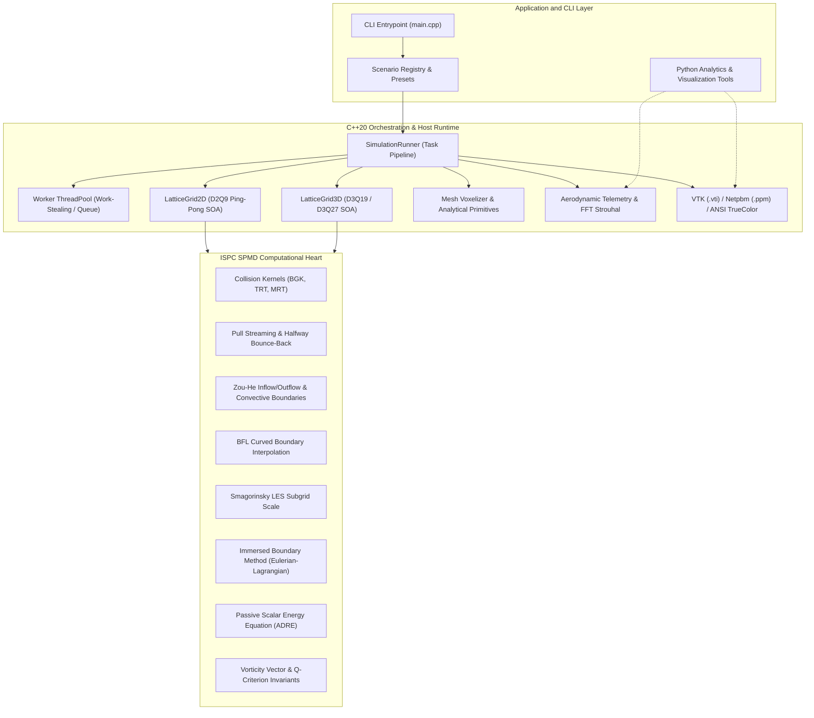
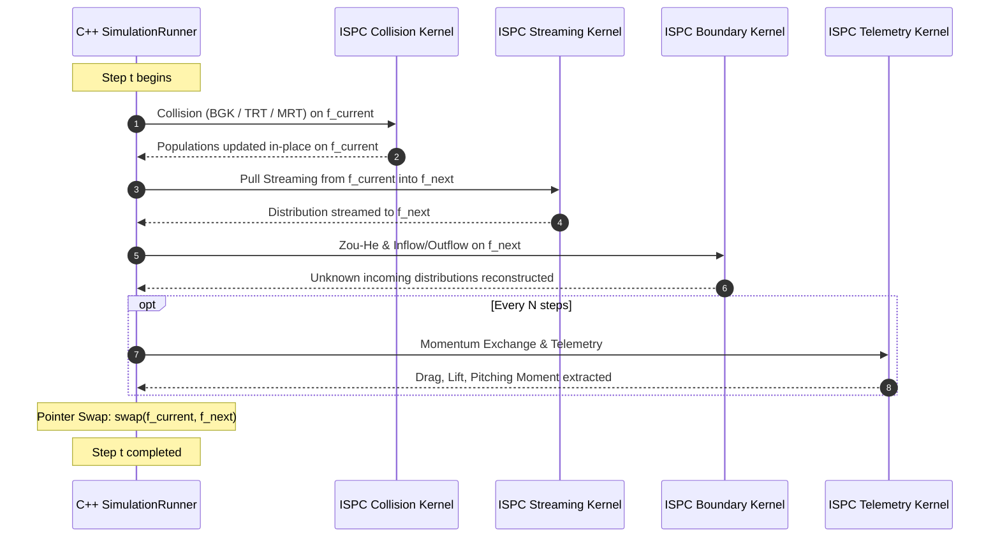

# Architecture and Engine Design

`wake` is an industrial-strength, highly optimized Computational Fluid Dynamics (CFD) simulation framework based on the Lattice Boltzmann Method (LBM). The computational heart of the engine is implemented in Intel SPMD Program Compiler (ISPC) kernels, vectorizing kinetic transport and collision operators across SIMD lanes (Intel AVX2, AVX-512, and ARM Neon). The host runtime is engineered in modern C++20, providing memory management, boundary condition dispatch, geometry voxelization, multi-threaded task scheduling, and post-processing export pipelines.

---

## 1. System Architecture Overview

The system architecture is structured in decoupled, cohesive layers:



---

## 2. Memory Architecture: Structure-of-Arrays (SoA)

The memory layout is the single most critical factor determining memory throughput in lattice Boltzmann simulations. In LBM, each grid node stores discrete distribution functions $f_i$ corresponding to lattice velocities $c_i$ ($Q = 9$ in 2D, $Q = 19$ or $27$ in 3D).

### 2.1 Array-of-Structures (AoS) vs. Structure-of-Arrays (SoA)

* **Array-of-Structures (AoS):** Storing velocities contiguously per node ($f_0, f_1, \dots, f_{Q-1}$ for node $(x,y,z)$, followed by node $(x+1,y,z)$).
  * In AoS, a SIMD vector load across adjacent spatial nodes requires strided gathers or packing shuffles, causing severe memory bandwidth degradation and cache pollution.
* **Structure-of-Arrays (SoA):** Storing all spatial values for velocity index $i$ contiguously, followed by all spatial values for velocity index $i+1$.
  * In SoA, spatial loops across $x \in [0, NX)$ map directly to continuous physical addresses. A vector load of width $W$ loads $W$ contiguous spatial cells in a single bus transaction without gather or scatter overhead.

`wake` enforces a strict Structure-of-Arrays layout across all 2D and 3D grid buffers:

$$\text{Offset}(x, y, z, i) = i \cdot (NX \cdot NY \cdot NZ) + z \cdot (NX \cdot NY) + y \cdot NX + x$$

```
Base Pointer
  │
  ├── [Population 0] ── [node 0, node 1, node 2, ... node (N-1)]  (Continuous 64-byte aligned)
  ├── [Population 1] ── [node 0, node 1, node 2, ... node (N-1)]  (Continuous 64-byte aligned)
  ├── [Population 2] ── [node 0, node 1, node 2, ... node (N-1)]  (Continuous 64-byte aligned)
  │   ...
  └── [Population Q-1] ─ [node 0, node 1, node 2, ... node (N-1)] (Continuous 64-byte aligned)
```

### 2.2 64-Byte Cache Line Alignment

All field allocations (`AlignedBuffer<T>`) are aligned to 64-byte boundaries using `posix_memalign` (or `_aligned_malloc` on Windows). This guarantees:
1. Zero unaligned load penalties on AVX-512 and ARM Neon architectures.
2. Prevention of false sharing across thread boundaries.
3. Optimal cache line prefetching by CPU hardware prefetchers.

---

## 3. Two-Grid Ping-Pong Buffer Management

LBM streaming involves reading from neighboring nodes. An in-place update introduces read-after-write hazards (data races).

`wake` implements a zero-copy two-grid ping-pong scheme:
* `f_current`: Source buffer containing populations after collision of step $t$.
* `f_next`: Destination buffer receiving streamed populations for step $t+1$.

At the conclusion of each time step, pointers are swapped in $O(1)$ time:
```cpp
std::swap(f_current_, f_next_);
```

No data is copied between buffers, maximizing effective memory bandwidth.

---

## 4. Execution Pipeline and Dataflow

The standard time-stepping loop operates as follows:



### 4.1 Fused Collision and Streaming Strategy

For memory-bound lattices, streaming and collision can be executed as separate passes or fused into a pull-streaming pattern:
* **Pull Streaming:** Each thread reads $f_i(\mathbf{x} - \mathbf{c}_i \Delta t, t)$ from neighboring nodes and writes directly to $f_i(\mathbf{x}, t + \Delta t)$.
* **Boundary Encapsulation:** Non-fluid solid cells execute halfway bounce-back directly during streaming:

$$f_{\bar{i}}(\mathbf{x}, t + \Delta t) = f_i(\mathbf{x}, t)$$

where $\bar{i}$ is the conjugate direction ($\mathbf{c}_{\bar{i}} = -\mathbf{c}_i$).

---

## 5. Collision Operators

`wake` implements three distinct collision models selectable at runtime:

1. **Bhatnagar-Gross-Krook (BGK):**
   * Single relaxation time $\tau$.
   * Computationally fast, ideal for moderate Reynolds numbers.
   * Stability deteriorates as $\tau \to 0.5$.

2. **Two-Relaxation-Time (TRT):**
   * Decouples symmetric (viscous) and anti-symmetric (acoustic/slip) moments.
   * Parameterized by magic parameter $\Lambda = (\tau_s - 0.5)(\tau_a - 0.5) = 1/4$ (or $3/16$).
   * Fixes wall boundary location independent of viscosity and eliminates unphysical slip.

3. **Multiple-Relaxation-Time (MRT):**
   * Maps populations to orthogonal moment space using transformation matrix $\mathbf{M}$:

$$\mathbf{m} = \mathbf{M} \mathbf{f}, \quad \mathbf{m}^{coll} = \mathbf{m} - \mathbf{S} (\mathbf{m} - \mathbf{m}^{eq}), \quad \mathbf{f}^{coll} = \mathbf{M}^{-1} \mathbf{m}^{coll}$$

   * Individual relaxation rates for energy, stress, and higher-order kinetic modes.
   * Maximum numerical stability for high Reynolds number aerodynamics.

---

## 6. Boundary Conditions Architecture

The boundary engine supports complex hydrodynamic configurations:

```
                  Top Wall: No-Slip Bounce-Back (Solid)
       ┌─────────────────────────────────────────────────────────┐
       │                                                         │
Inflow │ ──►                                                     │ Outflow
Zou-He │ ──►                 [Obstacle]                          │ Zou-He Pressure
Velocity│ ──►               (BFL Curved / MEM)                    │ or Convective
       │ ──►                                                     │
       └─────────────────────────────────────────────────────────┘
                 Bottom Wall: No-Slip Bounce-Back (Solid)
```

1. **No-Slip Wall (Halfway Bounce-Back):**
   * Exactly second-order accurate halfway between solid and fluid nodes.
2. **Zou-He Velocity Inflow:**
   * Prescribes parabolic or uniform velocity profile on West boundary.
   * Solves for unknown transverse distribution components using bounce-back of non-equilibrium parts.
3. **Zou-He Pressure Outflow:**
   * Prescribes constant exit density $\rho = 1.0$ on East boundary.
   * Relieves pressure reflections and preserves global mass balance.
4. **Convective Open Boundary:**
   * Solves wave equation $\frac{\partial f_i}{\partial t} + U_{conv} \frac{\partial f_i}{\partial x} = 0$ to sweep vortices cleanly out of domain.
5. **Bouzidi-Firdaouss-Lallemand (BFL) Curved Boundary:**
   * Quadratic/linear interpolation based on normalized wall distance fraction $q \in [0, 1)$.
   * Eliminates stair-step artifacts on rounded aerodynamic profiles.

---

## 7. Aerodynamic Force Telemetry: Momentum Exchange Method

Aerodynamic lift, drag, and moment coefficients are evaluated via the Momentum Exchange Method (MEM). For every boundary link connecting a fluid node $\mathbf{x}_f$ and a solid node $\mathbf{x}_b$:

$$\Delta \mathbf{P}_i = \mathbf{c}_i \left[ f_i(\mathbf{x}_f, t) + f_{\bar{i}}(\mathbf{x}_f, t + \Delta t) \right]$$

Net aerodynamic force is computed by summing momentum transfers across all active links:

$$\mathbf{F}_{aero} = \sum_{\text{links}} \Delta \mathbf{P}_i$$

Drag and lift coefficients are evaluated dynamically:

$$C_D = \frac{2 F_x}{\rho_0 U_{\infty}^2 D}, \quad C_L = \frac{2 F_y}{\rho_0 U_{\infty}^2 D}$$

Frequency analysis on $C_L(t)$ is conducted using a radix-2 Cooley-Tukey Fast Fourier Transform (FFT) to extract the dominant vortex shedding frequency $f_{shed}$ and calculate the Strouhal number:

$$St = \frac{f_{shed} D}{U_{\infty}}$$

---

## 8. Export and Post-Processing Architecture

The export subsystem provides zero-dependency outputs across scientific, visual, and telemetry formats:

1. **VTK XML ImageData (`.vti`):**
   * Binary-encoded structured grids with Little-Endian IEEE-754 floats.
   * Stores scalar fields (density, pressure, speed, vorticity, Q-criterion) and vector fields (velocity).
   * Generates `.pvd` collections for animated 3D visualization in ParaView.
2. **Netpbm PPM (P6):**
   * Direct binary 24-bit RGB image export.
   * Integrated scientific colormaps: Viridis, Inferno, CoolWarm.
3. **ANSI TrueColor Terminal Renderer:**
   * Real-time console rendering using 24-bit TrueColor escape codes and Unicode half-block characters (`▀`) to double vertical resolution.
4. **Telemetry CSV and JSON:**
   * Records time-series data for time step, Reynolds number, $C_D$, $C_L$, $C_M$, and vortex shedding frequency.
